English | [한국어](README.ko.md)

> This branch keeps the shared FC engine (20 DSP) for the comparison in 6.1. The final design is on `main`.

# Light Letter — FPGA Optical Link That Reads Handwriting and Sends It as Light

> This project was the final project of the [Consortium] On-Device AI System Semiconductor Design (Cohort 2) program.

Team 1 (L-LINK), 7 members · 2026.09.09~2026.10.15

| Member | Part | Main Work |
|:--|:--|:--|
| Seongjae Jo (Lead) ([@seongjaejo](https://github.com/seongjaejo)) | CNN | Convolution datapath, image preprocessing design and verification |
| Donghyun Kim ([@kimdh315](https://github.com/kimdh315)) | CNN | Conv controller, Max Pooling, Zero Gating, CNN integration and IP packaging |
| Yeonwoo Gim ([@mumallaeng](https://github.com/mumallaeng)) | CNN | Output Buffer, ReLU & Quantization, Fully Connected, ArUco crop, Web UI |
| Jongwoong Park ([@Critical-mankind](https://github.com/Critical-mankind)) | Optical link | BFSK transmitter design and verification, optical TX/RX circuits |
| Hoyeon Byeon ([@k948158](https://github.com/k948158)) | Optical link | BFSK receiver design and verification, UART firmware |
| Jaewon Kwon ([@kw0njw2222](https://github.com/kw0njw2222)) | FFT | FFT Buffer and Core design and verification |
| Gyeongmin Park ([@gyeongminbag27-arch](https://github.com/gyeongminbag27-arch)) | FFT | FFT Core Butterfly, Power design and UVM verification |

<p align="center">
  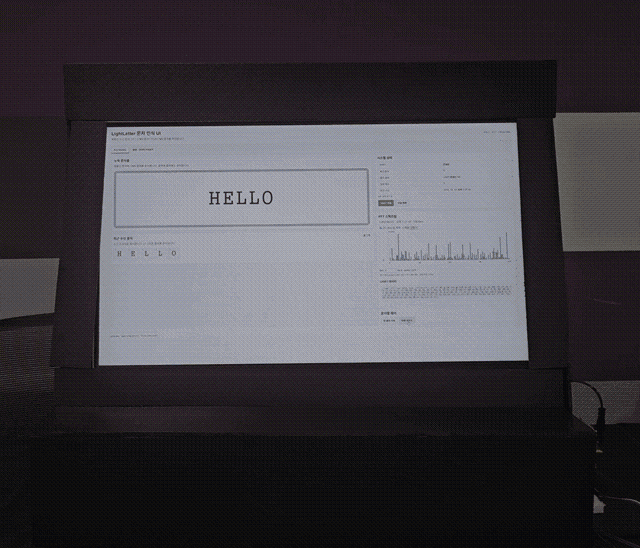
  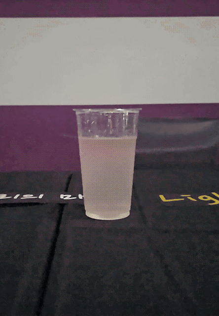
  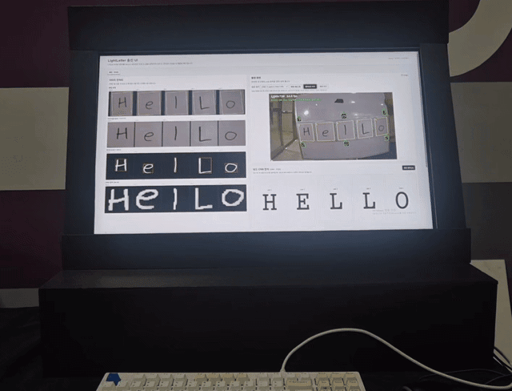
</p>
<p align="center">Final demo: receiver UI (left), optical path between the boards (middle), transmitter UI (right)</p>

# 1. Project Overview

## 1.1 Goal

Wireless links give mobility, flexible installation and scalability, but as long as they use radio they bring electromagnetic interference and the security risk of a signal that spreads in every direction. Light Letter started from the question "does wireless have to mean radio?" and set out to build an FPGA-based optical link that reads handwriting, sends it as light, and restores it on the other side.

A camera captures a handwritten letter on a whiteboard, an FPGA CNN accelerator recognizes it, the letter is sent on a laser beam with BFSK, and the receiving board finds the frequencies with an FFT to restore the letter. The goal was to integrate handwriting recognition (CNN), optical communication (BFSK) and signal processing (FFT) into one transmit-receive flow on two Zybo Z7-20 boards.

- Run handwriting preprocessing and CNN inference on a PL accelerator to cut time and power against the CPU.
- Pack each recognized letter into a packet and send it as a BFSK laser signal, so the asynchronous receiver can find the start and detect errors.
- Compute the frequency content of the received signal with a 128-point FFT, with real-time headroom over a CPU FFT.
- Show the recognized letter, the FFT spectrum and the restored letter on the transmitter and receiver UIs.

## 1.2 Scope

The scope covers camera input and ArUco-marker letter extraction (PS), image preprocessing and the CNN accelerator (PL), packet framing and BFSK optical transmission (PL) on the transmitter board; and photodiode input with XADC sampling, a 128-point FFT with power calculation, BFSK demodulation and CRC-8 check (PL), and UART output to a PC UI (PS) on the receiver board. The laser driver and the photodiode receiver circuit were built by the team.

Sending several letters at once, forward error correction and retransmission, and long-range or outdoor tests were left out and listed as improvements.

## 1.3 Summary

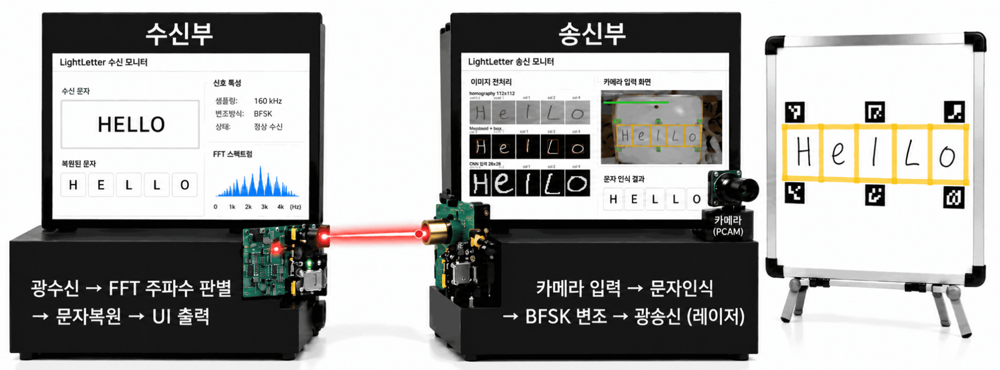

Light Letter combines a CNN, BFSK and an FFT around one idea: read the handwriting, send it as light, restore it. The transmitter runs camera input → letter recognition → BFSK modulation → laser transmission; the receiver runs light reception → FFT frequency detection → letter restoration → UI output.

Intended uses are passing notes in medical or industrial sites where radio is restricted, sharing text in secure spaces without an outside network, and an underwater slate that sends what was written to a receiver.

## 1.4 Specifications

| Item | Design |
|:--|:--|
| Boards | 2× Zybo Z7-20 (Zynq-7020): transmitter, receiver |
| Clocks | PL 100 MHz, PS (ARM Cortex-A9) 667 MHz |
| Camera input | Digilent Pcam 5C, stored in DDR by VDMA, 112×112 ROI from ArUco markers |
| CNN input | 28×28 grayscale, letter scaled to at most 22×22 keeping its aspect ratio, centered |
| CNN structure | Conv(3×3) 6 ch → Max Pool(2×2) → Conv(3×3) 16 ch → Max Pool(2×2) → FC 400→120→84→26 |
| Training | EMNIST uppercase, 26 classes, QAT (Quantization-Aware Training), 94.13% accuracy |
| Optical TX | Laser module switched by a 2N7000, BFSK |
| Optical RX | BPW34 photodiode, resistor divider, XADC (VAUX14, 12-bit) |
| BFSK frequencies | bit 0 60.096 kHz, bit 1 97.656 kHz, SYNC 120.192 kHz |
| Sampling | 961.538 kS/s (100 MHz / 104), 1 symbol = 256 samples (266.24 µs) |
| Packet | Preamble (4 SYNC symbols) + SFD 0xD5 + Frame ID + Data + CRC-8 (polynomial 0x07) |
| FFT | 128-point Radix-2 DIT, one reused Butterfly, decision bins 8, 13, 16 |
| PC output | PS7 UART1 at 115200 baud, CRLF-terminated CSV |

## 1.5 AS-IS / TO-BE

| Area | AS-IS | TO-BE |
|:--|:--|:--|
| Medium | Radio links suffer interference and leak in every direction | Letter transmission over light (laser), independent of radio |
| Input | Letters typed on a keyboard or read and relayed by a person | A camera shot of handwriting is recognized by an FPGA CNN |
| Recognition | Preprocessing and CNN on the CPU are slow and power-hungry | PL accelerator: 6.22× faster than the CPU, 57.7% less power |
| Detection | Signal level alone wavers on noise and bit boundaries | FFT power picks the frequency; packet and CRC catch errors |
| Signal processing | A CPU FFT leaves little real-time headroom | Pipelined FFT, 7.08× faster than the CPU |

# 2. Project Management

## 2.1 Schedule

| Phase | Period | Main Work |
|:--|:--|:--|
| Topic | 08.28~09.10 | Team setup, topic discussion and feasibility check |
| Roles | 09.11 | CNN, optical link and FFT parts and owners fixed |
| Design | 09.14~09.16 | CNN design, packet and BFSK spec, FFT structure |
| Implementation | 09.17~09.27 | CNN golden models and RTL, Vitis C code, BFSK TX/RX RTL, FFT RTL |
| Integration | 09.28~09.30 | Transmitter and receiver integration and debugging |
| Improvement and slides | 10.01~10.14 | Better preprocessing and demodulation, high-rate link settings (10.09), presentation |
| Final presentation | 10.15 | Final presentation and demo |

## 2.2 Roles

| Part | Member | Role | Main Work |
|:--|:--|:--|:--|
| CNN | Seongjae Jo (Lead) | Convolution and preprocessing | 3-channel Line Buffer and 3×3 Window, parallel MAC Array and adder tree, grayscale, polarity inversion and background removal, Bounding Box crop and 28×28 normalization, DDR–DMA–preprocess–CNN integration and verification |
| CNN | Donghyun Kim | Conv controller | Convolution controller, Max Pooling layer, Zero Gating, full CNN integration, AXI4-Lite CNN IP packaging |
| CNN | Yeonwoo Gim | Conv output and FC | Output Buffer that reorders Conv results, ReLU & Quantization, Fully Connected design and optimization, ArUco marker detection and crop in C, Web UI |
| Optical link | Jongwoong Park | BFSK transmitter | Frame generation, CRC-8 and BFSK modulation RTL, TX FSM and handshakes, AXI4-Lite and Vitis TX control, optical TX/RX circuits and board-to-board tests, RX UI and FFT spectrum transfer |
| Optical link | Hoyeon Byeon | BFSK receiver | BFSK packet RTL, CRC check, FFT-RX top integration, UART firmware and PC protocol, slides |
| FFT | Jaewon Kwon | FFT Buffer and Core | Ping-Pong Buffer input handling, FFT Core data flow and control, memory read/write structure, 128-point FFT top integration and tests, enclosure and slides |
| FFT | Gyeongmin Park | FFT Core and Power | Butterfly structure and tests, twiddle factor mem files, FFT power logic, Ping-Pong Buffer UVM, Butterfly UVM |

## 2.3 Development and Design Environment

| Category | Environment |
|:--|:--|
| Languages | Verilog (RTL), SystemVerilog/UVM (verification), C (Vitis apps, golden model), Python (QAT training, reference model, PC UI) |
| FPGA | 2× Zybo Z7-20 (Zynq-7020) |
| Peripherals | Pcam 5C camera, laser module, BPW34 photodiode, oscilloscope |
| EDA | Vivado 2020.2, Vitis 2020.2 |
| Verification | Vivado Simulator, UVM, Vivado ILA, Python and C golden models |
| Collaboration | Git, GitHub, Notion, Google Drive |
| Docs and editing | PowerPoint, Word, draw.io, Visual Studio Code, MobaXterm |

# 3. System Architecture

## 3.1 Overall Structure

The system has a transmitter board and a receiver board.

- **Transmit:** whiteboard → camera → image preprocessing → CNN (Conv, Pool, FC, Argmax) → packet and CRC → BFSK optical TX. One button press starts one capture and recognition, and the result is passed on as an 8-bit ASCII code.
- **Link:** the ASCII code becomes a 36-bit packet sent bit by bit as a BFSK laser signal.
- **Receive:** photodiode (BPW34) → XADC → FFT Buffer → FFT → FFT Power → BFSK demodulation → frame and CRC check → UI. The receiver UI shows the FFT spectrum and the restored letters.

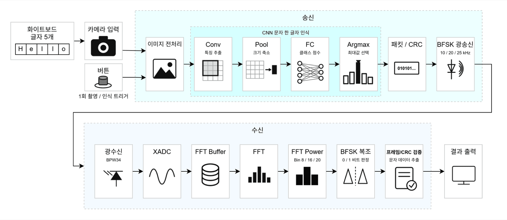

Pressing the button captures and recognizes the handwriting on the whiteboard, and the transmitter UI shows the captured frame, the preprocessed input and the recognized letter. The letter goes out on the laser, and the receiver restores it from the photodiode signal and shows it on its UI.

<p align="center">
  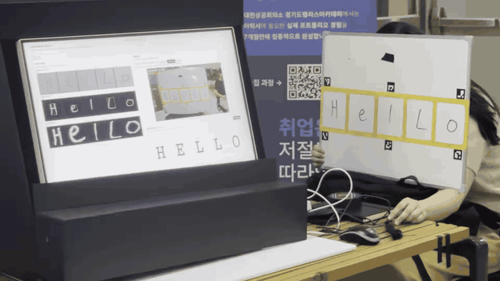
  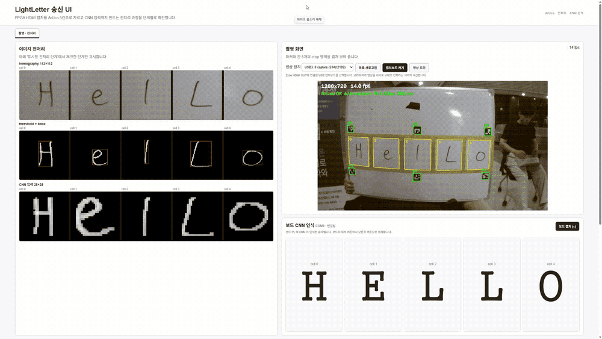
</p>
<p align="center">Transmitter capturing handwriting on the whiteboard (left), transmitter UI with frame, preprocessed input and result (right)</p>

<p align="center">
  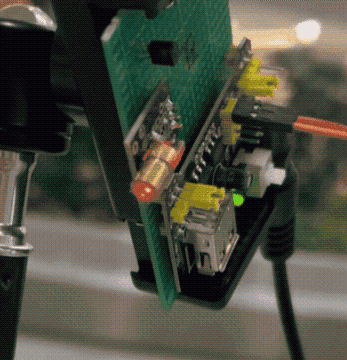
  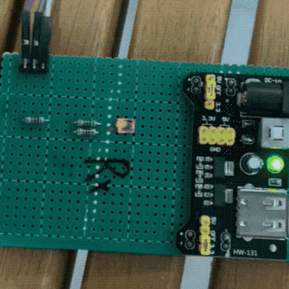
  
</p>
<p align="center">Laser transmitter (left), photodiode receiver board (middle), receiver UI with the received string and latest letters (right)</p>

On the transmitter, the PS handles the button (AXI GPIO), camera frame selection, ArUco perspective correction and ROI, DMA control, the CNN result (interrupt + AXI-Lite) and the BFSK TX driver. The PL holds VDMA, DMA, image preprocessing, the CNN accelerator and BFSK TX. On the receiver, the PL runs from the XADC to the CRC check, and the PS reads packets over AXI GPIO and sends them to the PC UI as UART CSV.

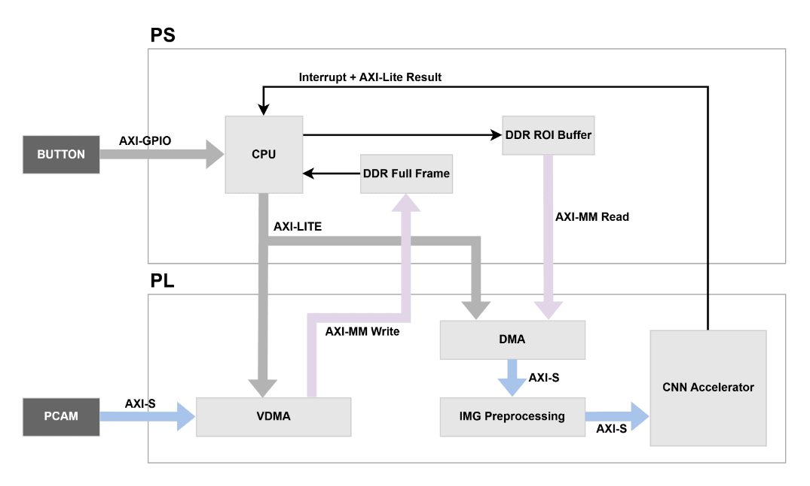

## 3.2 Theory and Background

### CNN and QAT

Two rounds of 3×3 convolution (stride 1) and 2×2 max pooling turn the 28×28 input into 6@26×26 → 6@13×13 → 16@11×11 → 16@5×5 feature maps, and FC layers reduce the 400 flattened values to 120 → 84 → 26 to pick one of A~Z. The model was trained with QAT, which applies the hardware bit widths during training so integer rounding is part of what the model learns; it reached 94.13%. Because the QAT model's Python output equals the hardware output, it served as the reference for the C golden model and RTL verification.

### BFSK and Packet Structure

The recognized letter becomes a packet, the packet becomes a light signal, the received light is parsed back into a packet, and the packet is decoded into an ID and a letter. BFSK represents bit 0, bit 1 and SYNC as light blinking at three different frequencies.

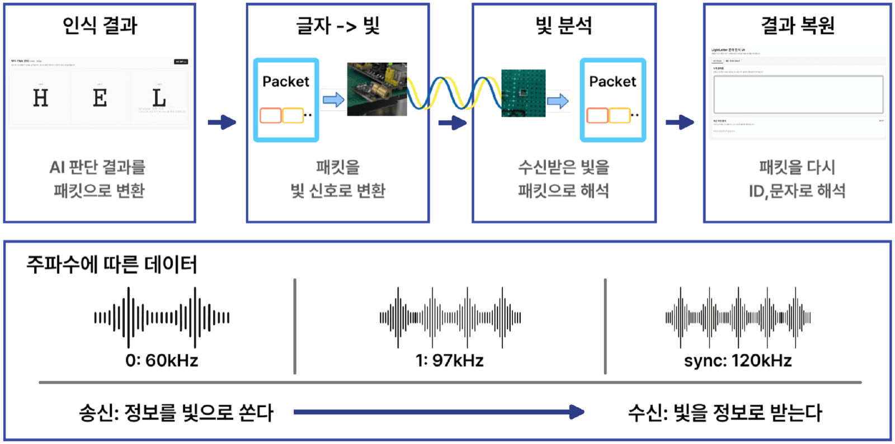

The link is asynchronous, so the receiver must find where the data starts. Data is therefore sent in packets that carry a start marker, a sequence number and an error check.

| Field | Role |
|:--|:--|
| Preamble | 4 SYNC symbols that tell the receiver where to synchronize |
| SFD | 0xD5, confirms the expected position |
| Frame ID | Sequence number |
| Data | ASCII code of the letter |
| CRC-8 | Polynomial 0x07; a packet with an error is dropped |

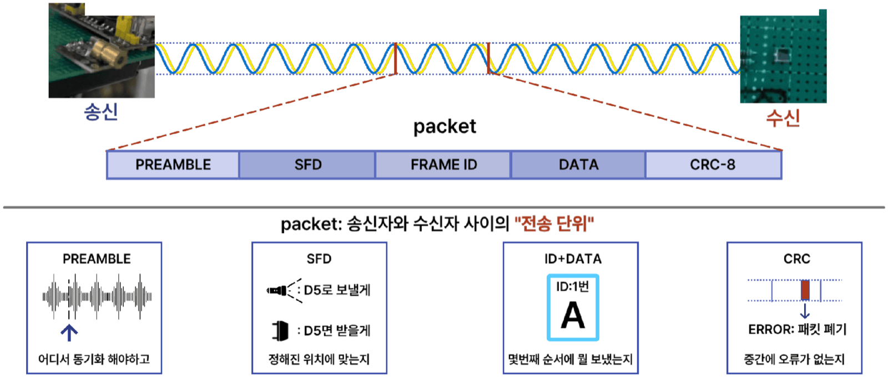

### Frequency Plan

The first design used 10, 20 and 25 kHz for bit 0, bit 1 and SYNC, sampled at 160 kS/s (bins 8, 16, 20). On October 9 both boards moved to bit 0 60.096 kHz, bit 1 97.656 kHz and SYNC 120.192 kHz at 961.538 kS/s (bins 8, 13, 16), and the gap between letters dropped from 10 ms to 0.4 ms, making packet transmission 6× faster (one packet per 9.6 ms). With the same 128-point FFT, a symbol (256 samples) shrank from 1.6 ms to 266.24 µs. Both plans put each target frequency on an FFT bin with a whole number of periods.

### FFT-Based Frequency Detection

The XADC turns the light level into numbers, the FFT Buffer collects 128 of them, the FFT Core splits them by frequency, and FFT Power takes each component's magnitude (Re² + Im²) for the detector to decide 0 or 1. In a Radix-2 DIT FFT, storing the input at bit-reversed addresses yields the output in natural order (bin 0 → 127), which keeps the later stages simple.

DC shows up in bin 0 and is excluded from the decision. Since each target frequency fits its bin with whole periods, the single-tone case needs no extra windowing multiply.

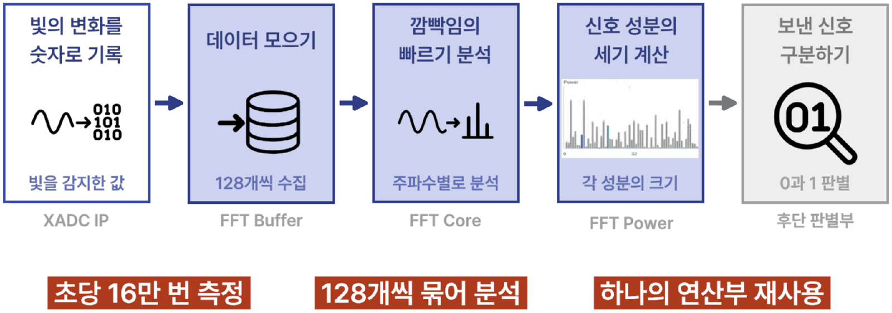

# 4. Detailed Design

## 4.1 CNN Accelerator

### Recognition Flow and Image Preprocessing

A letter in the camera image goes through capture and storage → letter area selection → preprocessing for recognition → CNN. On a button press the PS picks the frame VDMA stored in DDR and crops the letter into a 112×112 ROI using the ArUco markers. DMA sends the ROI to the PL for preprocessing and the CNN.

`img_preprocess` in the PL converts to grayscale and inverts polarity → thresholds at T = 160 → extracts the letter with a Bounding Box → scales it to at most 22×22 keeping the aspect ratio → centers it on a black 28×28 canvas, producing the CNN input (28×28, 16-bit). The aim is to match the training data (EMNIST): a large letter, the original aspect ratio and a margin around it.

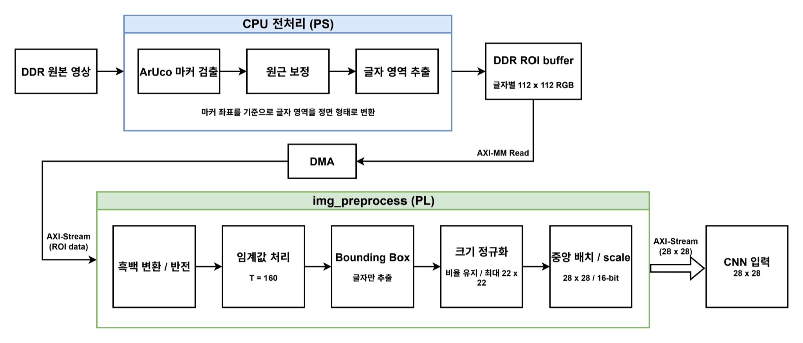

### Convolution: Line Buffer and MAC Array

The Line Buffer reuses input channels to form the 3×3 window, three channels are multiplied in parallel with weights from the Weight MEM, and an adder tree sums them into a partial sum. Conv2 (6 input, 16 output channels) splits ch0~2 into Phase 1 and ch3~5 into Phase 2 on the same Line Buffer and MAC Array, and the Output Buffer accumulates the two phases. The Conv controller steps through layers, phases and output channels.

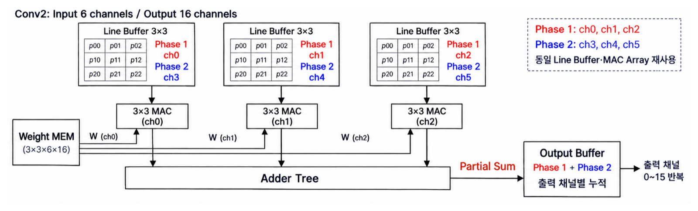

### Output Buffer, ReLU & Quantization

- Takes the 3-channel partial sums from the MAC Array and accumulates each phase with the bias and the stored value, per output channel.
- After accumulation, the 40-bit value goes through ReLU and the Quantizer reduces it to 16 bits.
- The Lane Packer groups channel values that arrive in pixel order into 3-channel words, and Out Reorder reads them back in channel order so Max Pooling gets one channel's pixels in a row.
- The 40-bit accumulation and ReLU/Quantization are split into register stages, with data and valid registered on the same clock to line up the MAC Array output with the Max Pooling input.

<p align="center">
  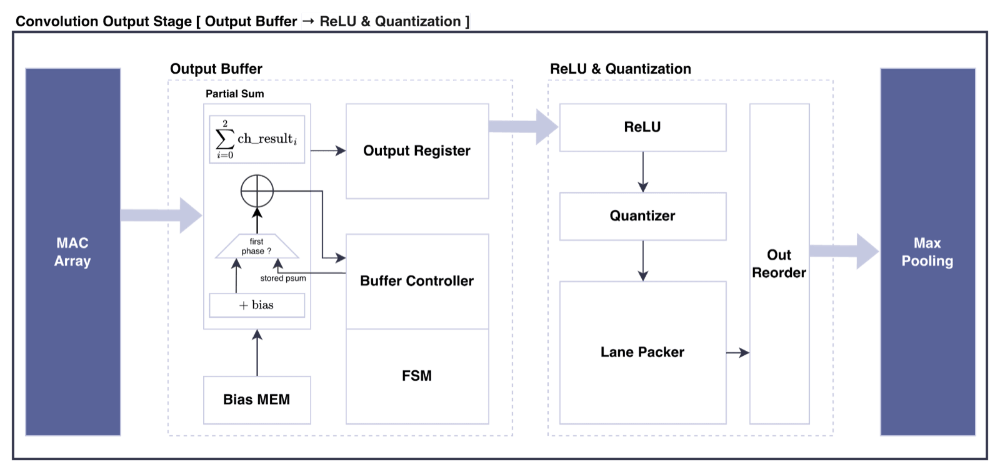
  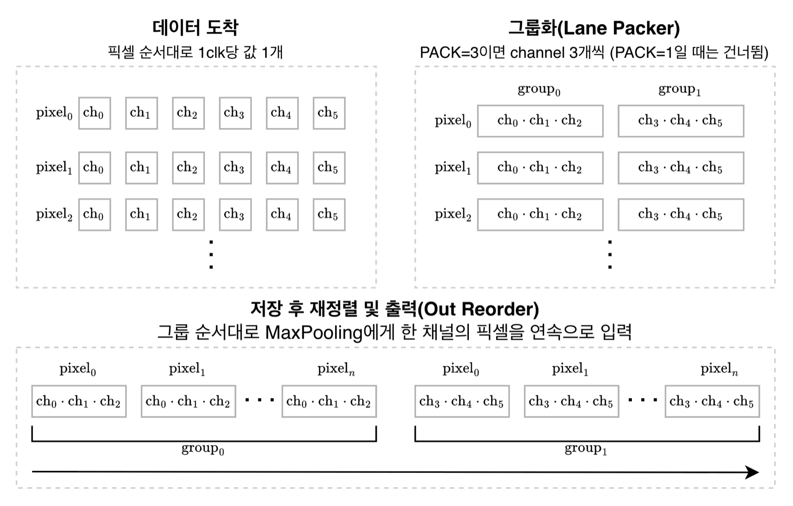
</p>
<p align="center">CNN block diagram - Output Buffer</p>

### Fully Connected

The FC reduces the 400 flattened inputs to 120 → 84 → 26, and ArgMax picks the class with the largest output. Two structures were designed and compared (results in 6.1).

- **Per-layer engine (40 DSP):** FC1, FC2 and FC3 have 25, 10 and 5 MACs of their own.
- **Shared engine (20 DSP):** a Feature Buffer (LUT-based distributed RAM) holds each layer's input, and the FC Controller switches the layer MUX and the weight and bias addresses so the three layers take turns on one shared MAC array.

<p align="center">
  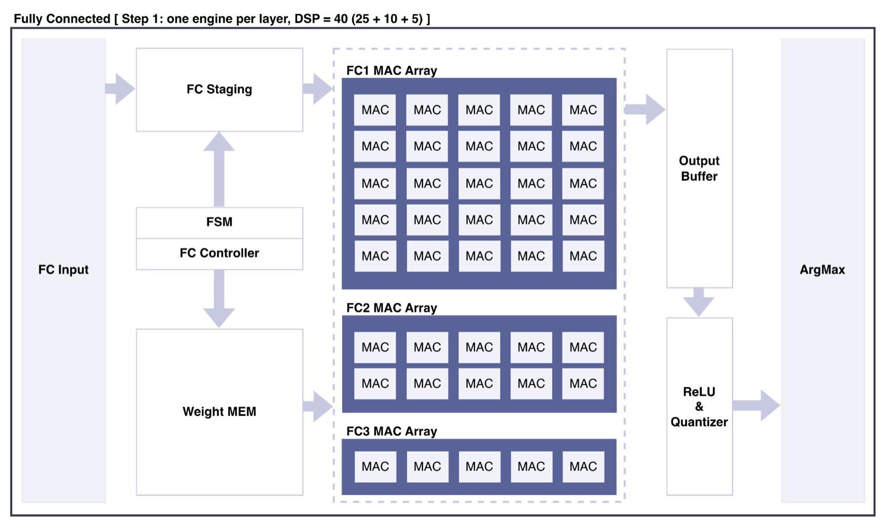
  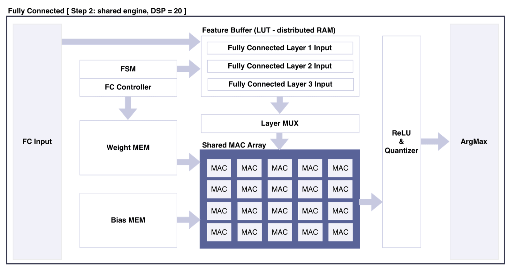
</p>

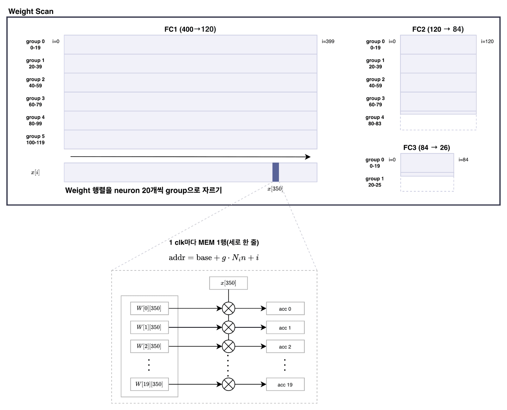

### Zero Gating and Zero Skipping

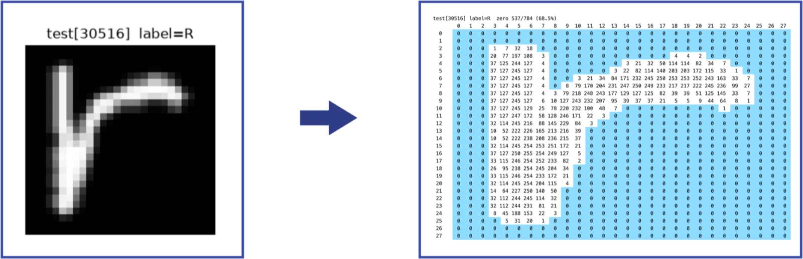

66.43% of the pixels in EMNIST inputs are 0, and anything times 0 is 0, so two thirds of the multiplications were unnecessary. A Zero Gating array in front of the Conv and FC MAC arrays holds the MAC inputs when the input is 0, so the multiplier does not toggle (less power). In the FC, a zero input is skipped and the engine moves straight to the next input (Zero Skipping), saving cycles (more speed). For example, if 3 of 6 FC inputs are 0, the work drops from 6 operations to 3.

<p align="center">
  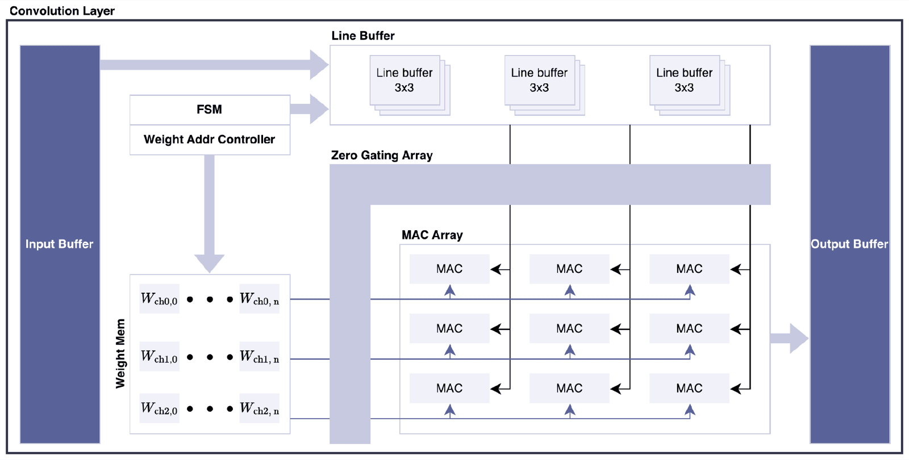
  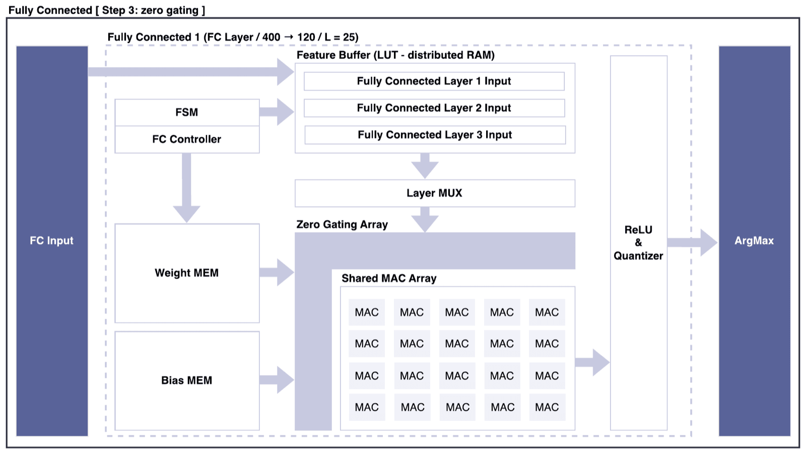
</p>
<p align="center">CNN block diagram - Zero Gating (left: Convolution, right: Fully Connected)</p>

## 4.2 BFSK Transmitter

When the AXI4-Lite TX wrapper receives the CNN result, the Frame Generator builds a frame from SFD, ID and DATA and appends the CRC-8. The TX FSM steps through IDLE → PREAMBLE → SFD → ID → DATA → CRC, moving to the next bit on each symbol-done signal; the BFSK Mapper turns bits into symbol types and the Carrier Generator turns symbols into blinking at each frequency, which drives the laser through a 2N7000.

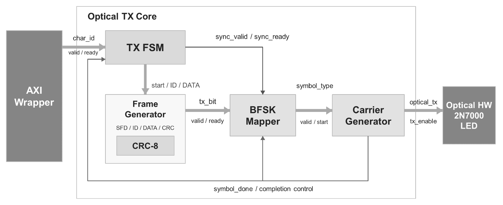

In Vitis the driver (`bfsk_tx.c`) and HAL (`bfsk_tx_hal.c`) are separate. The CNN-facing API `bfsk_tx_send_byte()` sends one letter and checks READY/BUSY, completion and timeout through the DATA (+0x00), CTRL (+0x04) and STATUS (+0x08) registers.

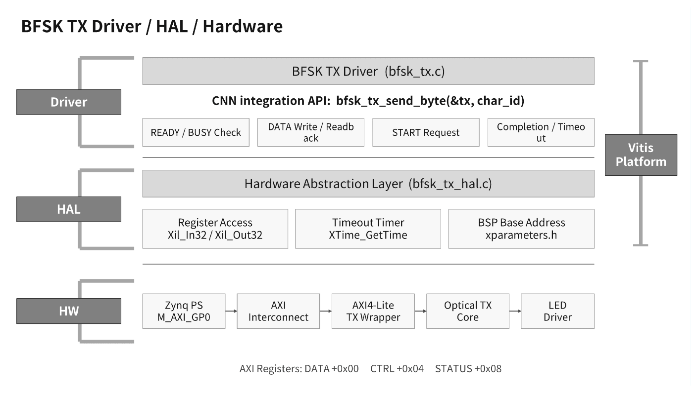

## 4.3 BFSK Receiver

The XADC samples the photodiode voltage, the 128-point FFT computes per-bin power, and the Bin Detector compares the bit 0, bit 1 and SYNC bins to decide each symbol. Symbol Detect & Sync collects the bit intervals after the preamble through SEARCH → WAIT_NON_SYNC → COLLECT → SCORE → SELECT → CHECK_SFD, and the Frame Decoder and CRC-8 check restore and verify the packet.

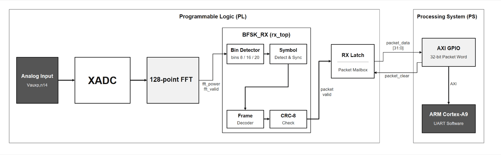

The result passes through the RX latch to the PS as a 32-bit packet word over AXI GPIO, and the PS application builds the UART output with a packet reader, error check and CSV formatter.

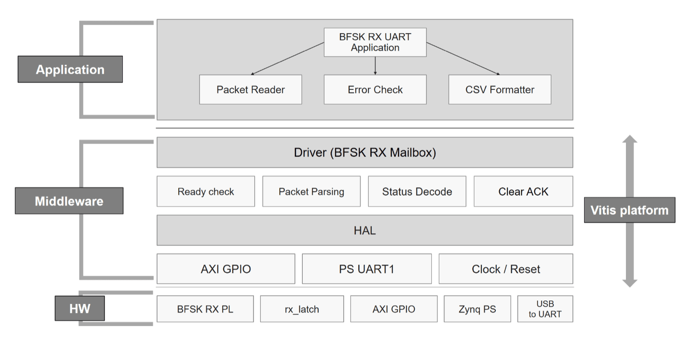

## 4.4 FFT

FFT Top chains the XADC (VAUX14, 12-bit) → FFT Buffer → FFT Core (128-point Radix-2 DIT) → FFT Power and outputs a 40-bit `power_result` with `fft_mag_valid`.

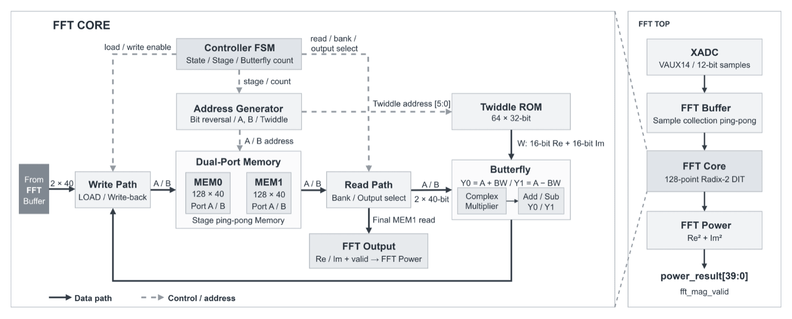

### FFT Buffer: Ping-Pong Structure

Two banks of 128 samples × 12 bits (64 × 24 bits) alternate, so sample collection and transfer to the core do not block each other. When a bank has 128 samples its Full flag goes to 1, `frame_valid && frame_ready` starts the frame transfer, and `buf_data_valid && buf_data_ready` passes 64 pairs of samples. After the last pair the Full flag returns to 0 and the bank is reused, so an unprocessed frame is never overwritten.


### FFT Core: One Butterfly and Address Generation

The FFT Core has a controller FSM, an address generator, dual-port memories (MEM0 and MEM1, 128 × 40 bits), a twiddle ROM (64 × 32 bits) and one Butterfly. After 64 butterflies in a stage, the read and write memories swap roles, for 7 stages in total. Reusing one circuit saves arithmetic resources, and keeping input and result in different memories avoids overwrites and simplifies control.

- **Input storage:** the input is stored at bit-reversed addresses (e.g. x[1] → MEM0[64]) so the result comes out in natural order.
- **Address generation:** A/B addresses come from inserting 0/1 at the stage position, and the twiddle address from the low stage bits of the count. Replacing per-stage case statements with one gap/mask/shift rule raised setup WNS from 0.766 ns to 0.887 ns (+0.121 ns) under the same conditions (XADC IP + FFT Top, 100 MHz).
- **Valid-based control:** ST_READ (address out, wait for the synchronous read) → ST_CALC (Butterfly) → ST_WRITE (store, update count) repeats. Read data and valid are registered together (`o_rdata_valid` → `i_read_data_valid`), and the address is held until the write completes (`i_wdata_valid`).

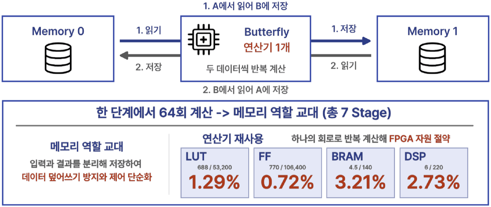

### From Multi-Cycle to Pipeline

The first RTL was multi-cycle: one pair had to finish read, compute and store before the next started. Where higher throughput is needed that wait limits real-time processing, so the core was changed to a pipeline that reads, computes and stores different pairs at the same time. The comparison is in 6.1.

<p align="center">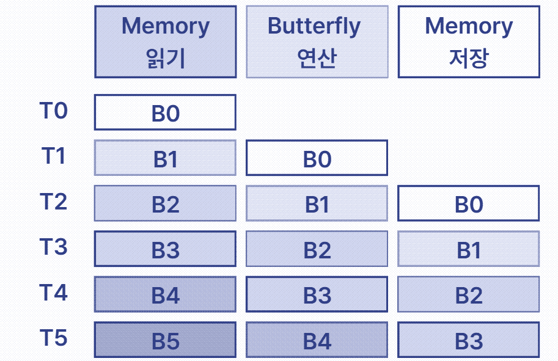</p>
<p align="center">Pipelined operation: read, compute and store overlap across pairs</p>

## 4.5 Optical TX/RX Circuits

- **Light source:** an infrared LED gave only 68 mV of swing at 10 cm, far too short a range. The laser module gave 2 V of swing and about 404 µA at the receiver at 1.6 m, so the laser became the final transmitter for the long-range goal.

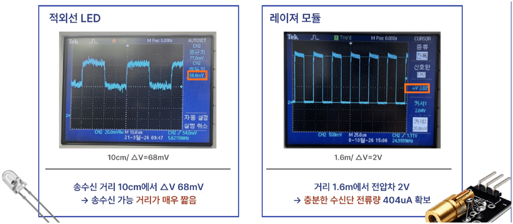

- **Receiver circuit:** with that much current already at the receiver, an op-amp stage would have needed an excessive output and distorted the waveform (see 6.2). A resistor divider without an op-amp brings 2.4 V down to 0.4 V, inside the XADC input range, and keeps the waveform intact.

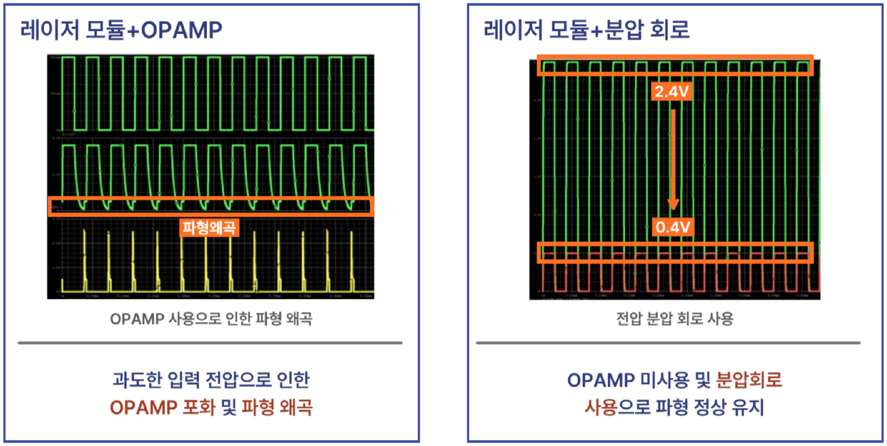

# 5. Verification

## 5.1 CNN Golden Model Comparison

The same inputs went through the Python QAT model, the C golden model and the RTL, and the three outputs were compared. Because QAT makes the Python output equal to the hardware output, the C model and then the RTL were matched to Python, and all three agree.

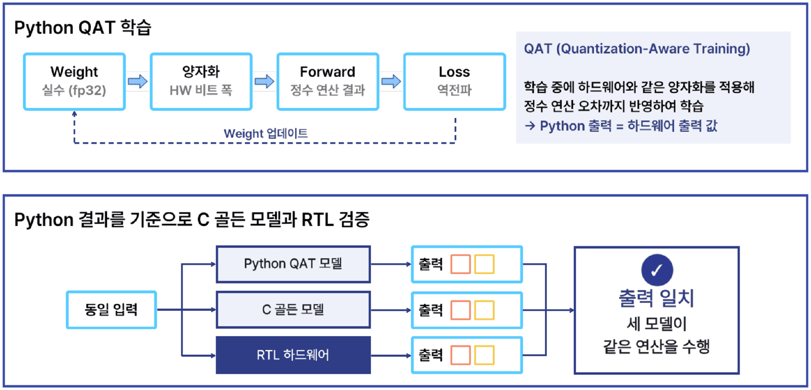

## 5.2 BFSK TX UVM

The BFSK transmitter (AXI-Lite TX wrapper, Optical TX Top, BFSK Mapper, Frame Generator, CRC-8, TX FSM, Carrier Generator) was verified in UVM: all 34 check items met, all 256 DATA values sent, 100% functional coverage.

| Category | Items | Checks |
|:--|:--:|:--|
| Normal and pattern packets | 8 | All 256 DATA values, alternating patterns (0x55, 0xAA), ID wrap, 832 packets in total |
| Reset recovery | 9 | Reset during preamble, data and CRC, output clear, normal packet afterwards |
| TX control | 5 | START ignored while busy, data held during TX, invalid START ignored, back to ready after done |
| AXI interface | 12 | Reads and writes, address/data arrival order, response delay, waiting follow-up requests |

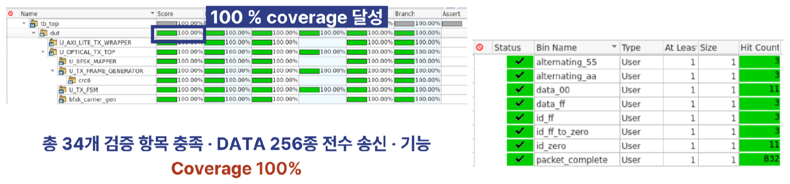

## 5.3 BFSK RX UVM

The BFSK receiver was verified in UVM with 328 scenarios and 100% coverage.

| Category | Count | Checks |
|:--|:--:|:--|
| Normal and random frames | 32 | Phase, valid spacing, ID and DATA combinations |
| Error and reset recovery | 38 | CRC and SFD errors, no signal, mid-frame reset, recovery from each state |
| Boundary and power | 96 | Decision thresholds, mixed and asymmetric power, SFD power sweep |
| Packet and classifier | 162 | Ambiguous, rejected and recovered packets, 40-bit power changes |

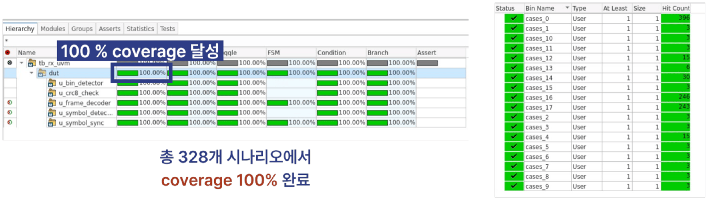

## 5.4 FFT Buffer UVM

All 7 directed functional bins were hit (100%): 64 simultaneous read/write cycles, use of both buffers (buffer 0 three times, buffer 1 twice), reuse of each buffer once, 4 inputs dropped while full, and 1 restart after space freed up. The randomized data section reached 1018/1024 bins (99.41%).

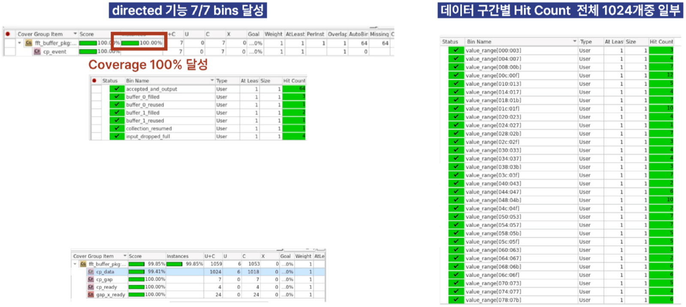

## 5.5 FFT Butterfly UVM

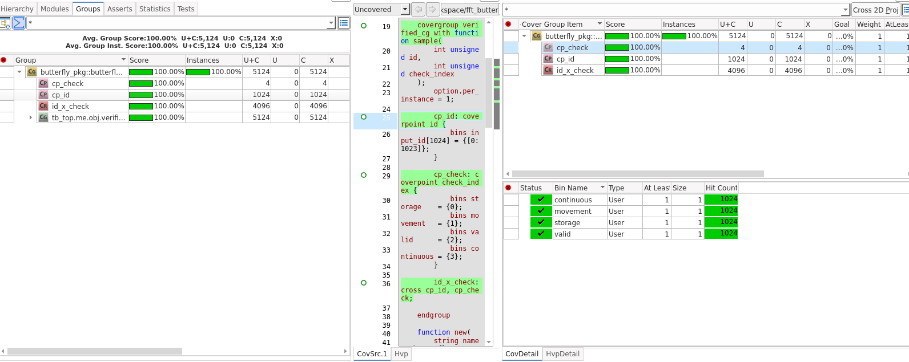

With 1,024 random inputs, the Butterfly pipeline was checked for per-stage storage, stage-to-stage movement, valid alignment and back-to-back operation. Each stage's data was compared with the expected value to make sure inputs never mixed, and valid latency, valid gaps mid-stream, extra inputs, unexpected outputs and mismatches were all checked. All 1,024 input-ID bins were hit, for 100% input-ID coverage.

## 5.6 Summary

| Target | Method | Result | Status |
|:--|:--|:--|:--:|
| CNN inference | Python QAT, C golden model and RTL compared | All three outputs match | Met |
| BFSK TX | UVM | 34 items, all 256 DATA values, 832 packets, 100% coverage | Met |
| BFSK RX | UVM | 328 scenarios, 100% coverage | Met |
| FFT Buffer | UVM | Directed 7/7 (100%), randomized 1018/1024 (99.41%) | Met |
| FFT Butterfly | UVM | Randomized 1024/1024 (100%) | Met |
| RX demodulation | Vivado ILA | frame_id increments without gaps, packet_error 0 | Met |

# 6. FPGA Results and Troubleshooting

## 6.1 FPGA Results

### Final Demo

The transmitter captured and recognized the five letters 'HELLO' and sent them by laser, and the receiver UI restored the same string along with the FFT spectrum. Handwriting recognition, the BFSK optical link and FFT signal processing ran as one system.

### CNN Accelerator Performance

Compared with preprocessing and the CNN on the CPU (667 MHz), the 100 MHz PL accelerator ran about 6× faster on a 6.7× slower clock.

| Item | CPU | CNN accelerator | Improvement |
|:--|:--|:--|:--|
| Time | 2582.13 µs | 415.15 µs | 6.22× |
| Power | 157.02 mW | 66.43 mW | 57.7% lower |
| Energy | 405.45 µJ | 27.58 µJ | 93.2% lower (14.7× efficiency) |

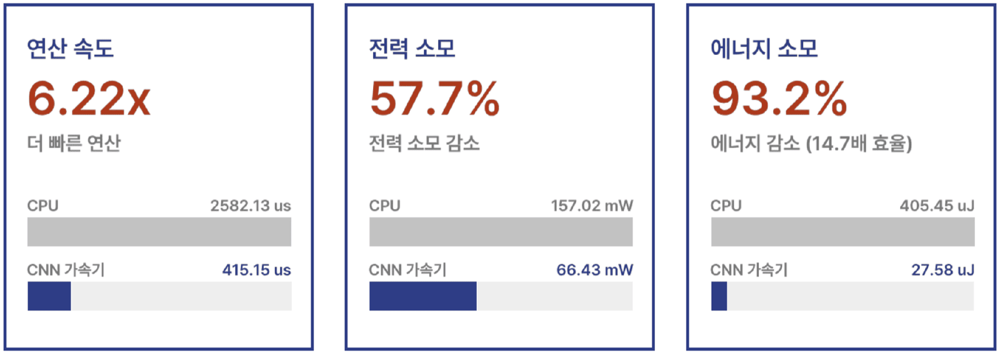

#### Zero Gating and Zero Skipping

Before and after Zero Gating and Zero Skipping: time 141.67 µs → 124.28 µs (12.3% shorter), power 93.38 mW → 88.75 mW (5% lower), energy 13.23 µJ → 11.03 µJ (16.6% lower).

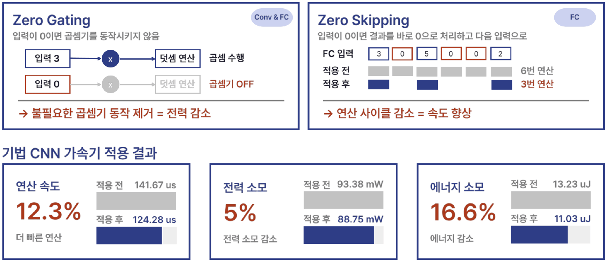

#### Shared FC Engine (40 DSP → 20 DSP)

The FC moved from a per-layer engine (FC1 25 + FC2 10 + FC3 5 = 40 DSP) to a shared engine in which the three layers take turns on 20 MACs (20 DSP). With the same weights both engines give bit-identical FC outputs (26 logits), and the board returned the same class for all 70 test images in all 10 runs (65/70 correct on the PL). The two engines are kept on the branches [`fc-dsp-40`](https://github.com/mumallaeng/LightLetter/tree/fc-dsp-40) and [`fc-dsp-20`](https://github.com/mumallaeng/LightLetter/tree/fc-dsp-20).

Both engines were measured under the same conditions, as an FC-only estimate and on the board.

- **Same conditions:** the two versions differ only in the FC RTL and the FC weight files. Preprocessing, Conv, BFSK, the block design, the PS software (Release `-O2`), the build scripts (Vivado/Vitis 2020.2), the board, the power adapter and the lab PC were the same, and both were built from scratch in the same order. The SHA-256 of the bitstream on the board was checked before every run so the versions never mixed.
- **FC alone (estimate):** only `fc_top` was synthesized and routed on xc7z020 with a 100 MHz constraint for resources and timing. For power, the routed netlist was simulated with the same testbench to record per-signal toggles (SAIF), which Vivado `report_power` used as the real switching activity. 99~100% of the netlist nets matched the SAIF, giving confidence level High. A timing-simulation SAIF with routed delays (SDF) was also checked to include glitches.
- **Board (measured):** on the Zybo Z7-20, with the camera and HDMI stopped, the 70 test images were processed on the PL while the time of each stage was recorded. Board power came from the current-monitor output of the power switch IC (TPS25940) sampled by the XADC at 1 kHz, 10 s per state over 3 rounds. Increases were taken against the WFI (idle) intervals right before and after, cancelling temperature and regulator drift.
- **Repetition:** the 20-DSP and 40-DSP versions were run alternately, 5 times each (10 runs), so drift over time could not land on one version. Raw logs, reports, SAIF files and bitstreams were kept with their hashes.

| Item | Per-layer engine (40 DSP) | Shared engine (20 DSP) | Change |
|:--|:--:|:--:|:--:|
| DSP48E1 | 40 | 20 | −20 (−50%) |
| LUT | 2,632 | 1,832 | −800 (−30.4%) |
| BRAM | RAMB36 31 + RAMB18 6 | RAMB36 35 | +1 (36 Kb equivalent) |
| Setup WNS (100 MHz) | +0.919 ns | +1.051 ns | +0.132 ns |
| FC cycles, input every clock | 3,229 | 3,216 | −13 |
| FC cycles, input 30%, output 15% | 3,477 | 4,195 | +718 |
| FC dynamic power, running (estimate) | 0.111 W | 0.103 W | −8 mW |
| FC dynamic power, idle (estimate) | 0.074 W | 0.005 W | −69 mW |
| Board PL preprocess + CNN time | 257.37 µs | 271.44 µs | +14.07 µs (+5.5%) |
| Board idle power (WFI) | 2,778.7 mW | 2,680.6 mW | −98.1 mW (−3.5%) |
| Board energy per inference | 1,093.9 µJ | 1,096.0 µJ | +2.1 µJ (+0.2%) |

The shared engine halves the DSPs, cuts the LUTs by 30% and gains timing slack. In exchange, preprocess + CNN on the board took 14.07 µs (5.5%) longer. When an input arrives every clock the two engines take almost the same cycles, but the more idle clocks the input has, the slower the shared engine gets. The per-layer engine has MACs for every layer and computes FC1 while the pool2 outputs are still arriving; the shared engine computes only the first FC1 output group with the input and the rest after all 400 inputs are in. On the board the pool2 outputs arrive with gaps, so the difference shows up in time. DMA and CPU times were the same for both versions, so the time difference comes from the FC alone. Across the 10 runs the time varied by less than 0.03 µs.

Idle power was 98.1 mW lower with the shared engine, and the ranges over 10 runs never overlapped (shared engine at most 2,692 mW, per-layer engine at least 2,766 mW). The cause is when the weight ROM reads: the per-layer engine's ROM reads every clock even with no work, while the shared engine's ROM reads only on clocks that issue a MAC. The FC-only idle difference of 69 mW (64 mW of it BRAM) is at the 1.0 V core; with an assumed regulator efficiency of 70~75% that is 92~99 mW at the 5 V input, in line with the board measurement.

Board energy per inference differs by 0.2%, effectively the same: the shared engine's lower power offsets its longer time. The transmitter board spends most of its time idle, waiting for a capture or a button press, so the shared engine, with half the DSPs and 98 mW less idle power, was adopted.

Board power assumes a 5.000 V input (not measured with a DMM), so read the difference between the two versions rather than the absolute values. FC-only power is a Vivado estimate, and linking the two through regulator efficiency uses an assumed efficiency, so it is only a magnitude check.

### FFT Performance

The first multi-cycle RTL was 1.34× faster than the CPU for the FFT core alone (51.407 µs → 38.43 µs) and 1.38× for core + power (53.021 µs → 38.44 µs). With the pipeline it became 7.08× faster than the CPU (53.021 µs → 7.49 µs, 85.87% shorter) and 5.13× faster than the first RTL (80.52% shorter).

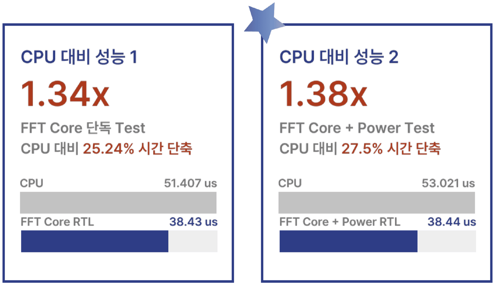

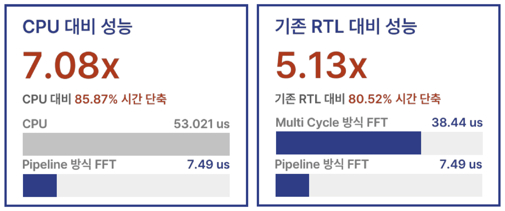

### FFT Resources and Timing

| Item | Result |
|:--|:--|
| LUT | 688 / 53,200 (1.29%) |
| FF | 770 / 106,400 (0.72%) |
| BRAM | 4.5 / 140 (3.21%) |
| DSP | 6 / 220 (2.73%) |
| Setup WNS / Hold WHS | +0.699 ns / +0.036 ns, 0 failing endpoints |
| On-chip power (Vivado estimate) | 0.142 W (dynamic 0.037 W + static 0.105 W) |

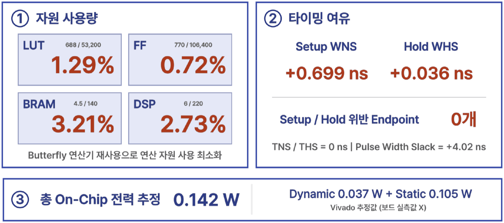

## 6.2 Root Cause Analysis

### CNN Input Mismatch

The trained CNN scored 94.13%, but in the real capture setup all five test letters (A~E) were read as 'WMAMR'. The cause was the difference in tilt, background and letter size between the training data and the camera input. Correcting the perspective in the PS with the ArUco marker coordinates, and changing the PL preprocessing from a gray filter with fixed sampling to threshold 160, Bounding Box extraction, scaling to at most 22×22 with the aspect ratio kept, and centering on a black 28×28 canvas, made the input consistent and raised the recognition rate.

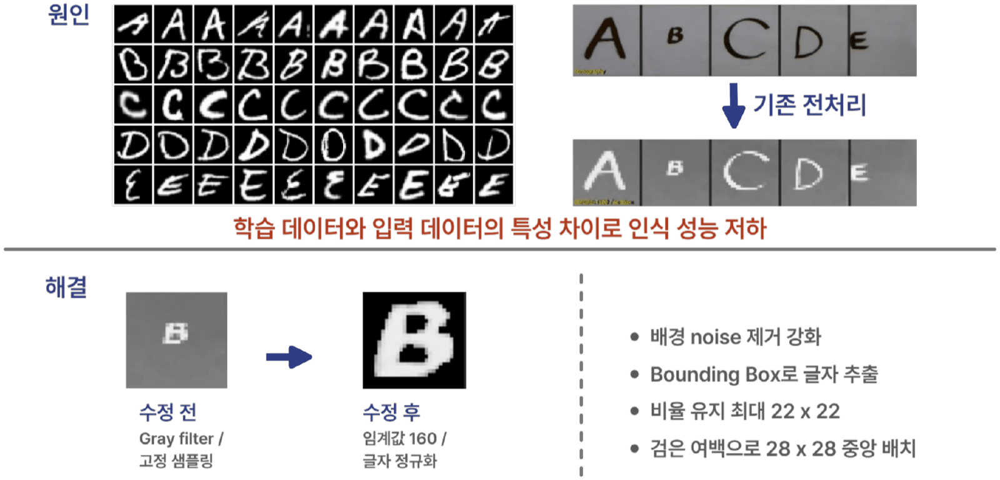

### Receiver Waveform Distortion from Op-Amp Saturation

With about 404 µA already at the receiver, adding op-amp gain asked for roughly 400 µA × 47 kΩ = 18.8 V at the output, so the op-amp saturated and the waveform distorted. Removing the op-amp and using a resistor divider to bring 2.4 V down to 0.4 V gave a clean waveform within the XADC input range (see 4.5).

### BFSK Demodulation at Bit Boundaries

Demodulation sometimes failed, giving IDs 178 and 181 instead of the expected 179 and 182. One bit spans two FFT windows, and the old logic used every other FFT result from the point the data became valid. When an FFT window straddled a bit transition, that result was still taken as valid and the bit was misread.

The fix sums two consecutive FFT results per bit and, between the two candidates (0+1)(2+3)... and (1+2)(3+4)..., picks the one that matches the 8-bit SFD pattern as the start. After the fix, the ILA showed frame_id counting 71, 72, 73 ... 78 without gaps, data holding 'A', and packet_error at 0.

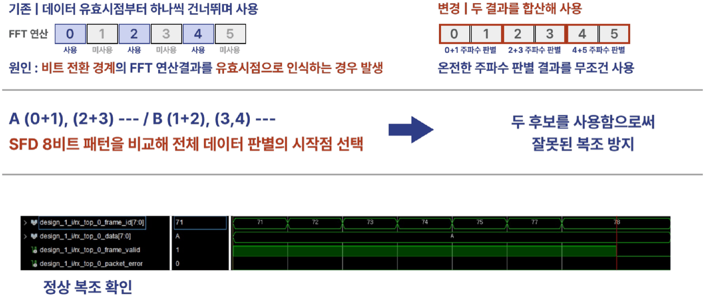

## 6.3 Improvements

- Extend the character set to lowercase and train on more images from the real capture setup to raise real-world accuracy.
- Add forward error correction and retransmission for long-range and ambient-light conditions.
- Extend the shared engine and Zero Skipping to the Conv stage, and check the Vivado power estimates against board measurements.
- Add a pipeline that captures, recognizes and sends several letters in a row, and automatic gain control on the receiver.

# 7. Conclusion

- Handwriting recognition with a CNN, the BFSK optical link and FFT signal processing were integrated into one transmit-receive system on two Zybo Z7-20 boards, and the demo showed 'HELLO' captured, recognized, sent as light and restored.
- The CNN accelerator was 6.22× faster than the CPU with 57.7% less power and 93.2% less energy, and Zero Gating and Skipping cut a further 12.3% of time and 16.6% of energy.
- The pipelined FFT runs in 7.49 µs (7.08× the CPU), meets 100 MHz timing and uses only 1~3% of the resources.
- BFSK TX, RX and the FFT Buffer were verified in UVM with 100% coverage (99.41% in the randomized section).

A highly accurate model still failed when its input differed from the training data, and a decision that was right in simulation still wavered at the bit boundaries of a real signal. Looking at the whole system, from input preparation and circuit behavior to signal boundaries, decided the results. Using the agreed packet spec and the Python and C golden models as the common reference for implementation and verification let seven people's modules come together into one working system in a short integration window.

# Repository Structure and How to Run

The two Zybo Z7-20 boards each have their own tree. Inside a board tree, each function block keeps its RTL, testbenches and models together, and `vivado/` and `vitis/` hold the board-level Vivado project scripts and Vitis workspace.

```text
tx/                 transmitter board: camera -> ArUco -> preprocess -> CNN -> BFSK TX
  cnn/              rtl/, ip/ (packaged cnn_ip), golden/ (C), model/ (Python), tb/
  preprocess/       img_preprocess RTL and testbenches
  aruco/            notebook, calibration, marker sheets, host test harness
  bfsk_tx/          BFSK TX RTL, testbenches, Nucleo checker firmware
  camera/           Digilent P-CAM / HDMI IP repository
  ui/               capture-board viewer (START_UI.cmd)
  vivado/           create_project.tcl, block design Tcl, constraints/, export/ (XSA)
  vitis/            Vitis workspace: tx_fpga, tx_fpga_system, tx_top_wrapper
rx/                 receiver board: XADC -> FFT -> BFSK RX -> UART -> PC UI
  fft/  bfsk_rx/  snapshot/  ui/
  vivado/  vitis/  prebuilt/  tools/  docs/
legacy/             unused or superseded sources, kept under their old paths
assets/readme/      README figures
```

Requires Vivado and Vitis 2020.2 on Windows. Each board tree has `CREATE_VIVADO.cmd` and `CREATE_VITIS.cmd` that rebuild the project from scripts with paths relative to the script, so a fresh clone works on any PC.

### Receiver board

1. `rx\CREATE_VIVADO.cmd` creates `rx\vivado\project\rx_final.xpr`.
2. `rx\CREATE_VITIS.cmd` creates `rx\vitis\workspace` from `rx\vivado\export\FFT_RX_FINAL.xsa` and builds the `BFSK_RX_UART` app.
3. Open `rx\vitis\workspace` in Vitis and run `BFSK_RX_UART` on the board. Prebuilt files are in `rx\prebuilt\`.
4. `rx\START_UI.cmd` starts the PC UI at `http://127.0.0.1:8765`. Close any serial terminal that holds the board's COM port first. The UART format is in `rx/docs/rx_uart_protocol.md`.

### Transmitter board

1. `tx\CREATE_VIVADO.cmd` creates `tx\vivado\project\tx_top.xpr`. Generate the bitstream, and export the XSA to `tx\vivado\export\` when the hardware changes.
2. Export the hardware (including bitstream) to `tx\vivado\export\tx_top_wrapper.xsa`, then run `tx\CREATE_VITIS.cmd`. It creates `tx\vitis\workspace`, generates the platform/BSP and builds `tx_fpga`. Running it again updates the platform from the same XSA and rebuilds. Close Vitis if it is using this workspace before running the script.
3. Open `tx\vitis\workspace` in Vitis and run `tx_fpga` on the board. The app links the original `tx\vitis\tx_fpga\src` sources, so later source edits are included when rebuilt. The launcher uses `C:\Xilinx\Vitis\2020.2\bin\xsct.bat`; adjust `BFSK_XSCT` if Vitis is installed elsewhere.
4. `tx\START_UI.cmd` starts the capture-board viewer. Install its packages once with `pip install -r tx\ui\requirements.txt`.

The BFSK TX history is imported from Critical-mankind/BFSK_Tx. BFSK TX RTL and testbenches are in `tx/bfsk_tx/`, and the Nucleo receiver test is in `tx/bfsk_tx/nucleo_checker/`.

# References

- [1] Digilent, Zybo Z7 Reference Manual. https://digilent.com/reference/programmable-logic/zybo-z7/reference-manual
- [2] Digilent, Pcam 5C Reference Manual. https://digilent.com/reference/add-ons/pcam-5c/reference-manual
- [3] AMD, 7 Series FPGAs and Zynq-7000 SoC XADC Dual 12-Bit 1 MSPS Analog-to-Digital Converter User Guide (UG480). https://docs.amd.com/r/en-US/ug480_7Series_XADC
- [4] AMD, Vivado Design Suite User Guide: Getting Started (UG910). https://docs.amd.com/r/en-US/ug910-vivado-getting-started
- [5] AMD, Vitis Unified Software Platform Documentation: Embedded Software Development (UG1400). https://docs.amd.com/r/en-US/ug1400-vitis-embedded
- [6] G. Cohen, S. Afshar, J. Tapson, A. van Schaik, "EMNIST: an extension of MNIST to handwritten letters," 2017. https://arxiv.org/abs/1702.05373
- [7] OpenCV, Detection of ArUco Markers. https://docs.opencv.org/4.x/d5/dae/tutorial_aruco_detection.html
- [8] Vishay, BPW34 Silicon PIN Photodiode Datasheet. https://www.vishay.com/docs/81521/bpw34.pdf
